# 📋 แผนการดำเนินงานพัฒนา (Implementation Plan)
## โครงการเว็บแอปพลิเคชัน 3D จำลองบรรยากาศ "งานประเพณีลอยกระทง" แบบ Interactive

> **สถานะโครงการ:** อยู่ในขั้นตอนการวางแผน (ยังไม่เริ่มเขียนโค้ดตามคำสั่ง)  
> **เทคโนโลยีหลัก:** Three.js, Vite, WebGL, Canvas 2D API (Procedural Textures), CSS Glassmorphism  
> **ข้อกำหนดสำคัญ:** ไม่ใช้ไฟล์โมเดล 3D หรือรูปภาพจากภายนอก (100% Procedural Generation) เมนูภาษาไทยทั้งหมด

---

## 🎯 1. วัตถุประสงค์และขอบเขตของแผนงาน (Objectives & Scope)

แผนการดำเนินงานฉบับนี้กำหนดขั้นตอนการพัฒนาทีละสเต็ป (Step-by-step Execution Plan) อย่างเป็นรูปธรรม เพื่อให้มั่นใจว่าเมื่อเริ่มลงมือเขียนโค้ดจริง จะได้ผลงานที่:
1. **สวยงาม สมจริง และมีชีวิตชีวา:** มีการเคลื่อนไหวของคลื่นน้ำ, แสงเทียนวูบวาบ, แสงสะท้อนจันทร์, โคมลอยยี่เป็ง, พลุสะท้อนน้ำ และฝูงชนจำลอง
2. **ระบบการโต้ตอบครบถ้วน:** เลือกกระทง, พิมพ์ชื่อ-คำอธิษฐาน, ปล่อยกระทง, ชี้/คลิกอ่านคำอธิษฐานของผู้อื่น, จุดพลุ, สลับมุมกล้อง
3. **เสถียรและโหลดไว 100%:** สร้างรูปทรง เรขาคณิต พื้นผิว และอนุภาคทั้งหมดผ่านโค้ด JavaScript/GLSL โดยไม่เสี่ยงกับปัญหาลิงก์โมเดลหรือรูปภายนอกเสีย (Zero External Asset Dependency)

---

## 🗓️ 2. แผนการพัฒนาแบบแบ่งเฟส (Detailed Phase & Task Breakdown)

```mermaid
gantt
    title แผนการดำเนินงานพัฒนาเว็บแอป 3D ลอยกระทง
    dateFormat  X
    axisFormat %d

    section เฟส 1: โครงสร้างหลัก
    ตั้งค่า Vite + Three.js + Postprocessing :active, p1_1, 0, 1
    ระบบสร้าง Procedural Textures ด้วย Canvas :p1_2, 1, 2

    section เฟส 2: ฉากและสภาพแวดล้อม
    ระบบผิวน้ำ คลื่นน้ำ และแสงสะท้อน :p2_1, 2, 4
    ท้องฟ้าราตรี พระจันทร์ ดาว และโคมยี่เป็ง :p2_2, 3, 5
    ท่าน้ำไม้ เจดีย์ทอง ธงราว ซุ้มงานวัด :p2_3, 4, 6

    section เฟส 3: ตัวละครและฝูงชน
    โมเดลคนสไตล์ Low-poly หลากบทบาท :p3_1, 5, 7
    ระบบอนิเมชันเดิน ยืนชมวิว และก้มลอยกระทง :p3_2, 6, 8

    section เฟส 4: กระทงและระบบลอยน้ำ
    โมเดล 3D กระทง 3 แบบ (ใบตอง, บัว, กะลา) :p4_1, 7, 9
    เปลวเทียนไหว + PointLight + ควันธูป :p4_2, 8, 10
    ระบบฟิสิกส์ลอยน้ำ โคลงเคลงตามคลื่น (Buoyancy) :p4_3, 9, 11

    section เฟส 5: UI และการโต้ตอบ
    หน้าต่าง Glassmorphism ภาษาไทย :p5_1, 10, 12
    ระบบปล่อยกระทง และคำอธิษฐานผู้อื่น (Raycaster) :p5_2, 11, 13

    section เฟส 6: พลุ แสงฟุ้ง และกล้อง
    ระบบพลุดอกไม้ไฟ + แสงวาบสะท้อนผิวน้ำ :p6_1, 12, 14
    กล้องอิสระ Orbit + กล้องติดตามกระทง (Follow) :p6_2, 13, 15
    แสงฟุ้ง UnrealBloomPass ปรับแต่งความสว่าง :p6_3, 14, 16

    section เฟส 7: ตรวจสอบและทดสอบ
    รัน Dev Server, Browser Testing, แก้ไขจุดบกพร่อง :p7_1, 15, 17
```

---

### 🔹 เฟสที่ 1: การวางรากฐานและระบบสร้างพื้นผิว (Foundation & Procedural Texture Engine)
* **Task 1.1: Project Setup**
  * กำหนดค่า `package.json` ติดตั้ง `three` และ `vite`
  * ออกแบบโครงสร้างโฟลเดอร์แบบโมดูลาร์ แยกส่วนประกอบชัดเจน (`scene/`, `models/`, `systems/`, `ui/`, `utils/`)
* **Task 1.2: Procedural Texture Generator (`utils/textureGenerator.js`)**
  * เขียนฟังก์ชันสร้างภาพพื้นผิวผ่าน HTML5 2D Canvas ในหน่วยความจำ:
    * *ลายใบตอง (Banana Leaf Texture):* เส้นลายใบไม้สีเขียวเข้มสลับเขียวตองอ่อน
    * *ลายไม้ท่าน้ำ (Wood Plank Texture):* ลายเสี้ยนไม้ธรรมชาติสีน้ำตาลเข้ม
    * *ลายกลีบดอกบัว (Lotus Petal Texture):* การไล่เฉดสีชมพูขาว (Gradient)
    * *ลายผิวกะลามะพร้าว (Coconut Shell Texture):* พื้นผิวจุดละเอียดสีน้ำตาลเข้ม
    * *Normal Map ผิวน้ำ (Water Normal):* ลายระลอกคลื่นสำหรับสร้างแสงสะท้อนบนผิวน้ำ
    * *อนุภาคเรืองแสง (Glow Particle Texture):* รัศมีแสงนวลสำหรับสะเก็ดไฟและควัน

---

### 🔹 เฟสที่ 2: สภาพแวดล้อมและบรรยากาศคืนเพ็ญ (Environment & Atmosphere)
* **Task 2.1: แม่น้ำและการเคลื่อนไหวของระลอกคลื่น (`scene/river.js`)**
  * สร้างผืนน้ำขนาดใหญ่ด้วย `PlaneGeometry` ปรับความละเอียด Vertex ให้พอเหมาะ
  * เขียนสมการคลื่นใน Animation Loop อัปเดตตำแหน่งจุดยอด (Vertex Y displacement) เพื่อให้ผิวน้ำกระเพื่อมตลอดเวลา
  * ปรับค่าวัสดุ `MeshStandardMaterial` ให้เกิดการสะท้อนของแสงจันทร์ (Moonlight Specular Highlights)
* **Task 2.2: ท้องฟ้าราตรี พระจันทร์ และดวงดาว (`scene/sky.js`)**
  * ท้องฟ้าโดมสีน้ำเงินเข้มเหลือบดำ (Midnight Blue Gradient Sky)
  * ดวงจันทร์เพ็ญดวงโต เรืองแสงสีนวล พร้อมแสง `DirectionalLight` มุมเฉียงส่องลงสู่แม่น้ำ
  * ท้องฟ้าประดับด้วย `Points` ดวงดาวกว่า 1,500 ดวงที่กะพริบไหวช้าๆ
* **Task 2.3: โคมลอยยี่เป็งเรืองแสง (`scene/lanterns.js`)**
  * โมเดลโคมยี่เป็งทรงกระบอกมน วัสดุกึ่งโปร่งแสง มีแสงไฟสีส้มอยู่ภายใน
  * ระบบปล่อยโคมลอยขึ้นสู่ท้องฟ้าอย่างต่อเนื่อง มีการส่ายไปมาตามกระแสลมเบาๆ และหมุนวนช้าๆ
* **Task 2.4: ท่าน้ำไม้และฉากงานวัด (`scene/pier.js`)**
  * โครงสร้างสะพานท่าน้ำไม้แบบไทยยื่นลงสู่แม่น้ำ พร้อมเสาเข็มและบันไดลงน้ำ
  * เจดีย์ทรงไทยเรืองแสงสีทองอร่าม (Golden Pagoda) ประดิษฐานเป็นฉากหลังริมฝั่ง
  * เสาประดับโคมไฟกระดาษหลากสี และสายธงสามเหลี่ยมงานวัด 7 สีพลิ้วไหว

---

### 🔹 เฟสที่ 3: ตัวละครและฝูงชนจำลอง (Animated Crowd Characters)
* **Task 3.1: สร้างโมเดลตัวละคร Low-poly (`models/crowdGenerator.js`)**
  * สรรสร้างตัวละครสไตล์ Low-poly มีชีวิตชีวา (ลำตัว แขน ขา ศีรษะ เครื่องแต่งกายหลากสีสัน)
  * ใช้ Primitive Geometries เพื่อให้เรนเดอร์ลื่นไหลที่ 60 FPS
* **Task 3.2: ระบบอนิเมชันและพฤติกรรมตัวละคร (Behaviors)**
  * *กลุ่มคนเดินเที่ยว (Walkers):* เดินวนไปมาตามทางเดินท่าน้ำ มีอนิเมชันแกว่งแขนและขยับขา
  * *กลุ่มยืนชมบรรยากาศ (Spectators):* ยืนริมตลิ่ง แหงนมองโคมลอย หรือก้มมองกระทงในแม่น้ำ
  * *กลุ่มคนลอยกระทง (Floaters):* ตัวละครนั่งคุกเข่าบริเวณขั้นบันไดท่าน้ำ ทำท่าประคองกระทงปล่อยลงสู่ผิวน้ำเป็นระยะ

---

### 🔹 เฟสที่ 4: โมเดลกระทง 3 มิติและระบบฟิสิกส์ลอยน้ำ (Krathong Models & Buoyancy)
* **Task 4.1: สร้างโมเดลกระทง 3 รูปแบบ (`models/krathongGenerator.js`)**
  1. *กระทงใบตองดั้งเดิม:* ฐานหยวกกล้วย, กลีบใบตองพับจีบซ้อนชั้นแบบเรเดียล, ประดับดอกดาวเรืองสีเหลืองสด
  2. *กระทงดอกบัวสวรรค์:* กลีบบัวสีชมพูไล่เฉดขาวบานสะพรั่ง, ฐานกลีบเลี้ยงสีเขียว, เกสรดอกไม้สีทอง
  3. *กระทงกะลามะพร้าว:* กะลาขัดเงาสีน้ำตาล, เทียนหล่อในกะลา, โรยด้วยกลีบดอกไม้หลากสี
* **Task 4.2: ระบบเทียน ธูป และควัน**
  * เปลวไฟเทียนไขจำลองจาก Tear-drop Mesh ขยับสั่นไหวด้วย Perlin/Sine Math
  * ติดตั้ง `PointLight` สีส้มอบอุ่น (`#FF9900`) ที่กะพริบไหวตามเปลวไฟ ส่องกระทบกลีบกระทงและผิวน้ำ
  * ธูป 3 ดอก ยอดธูปติดไฟสีแดงเรื่อ พร้อม Particle ควันจางๆ ลอยวนขึ้นด้านบน
* **Task 4.3: ระบบฟิสิกส์การลอยน้ำ (Buoyancy & Wave Interaction: `systems/floatingPhysics.js`)**
  * ฟังก์ชันคำนวณความสูงของผิวน้ำ $Y$ ณ ตำแหน่ง $(X, Z)$ ของกระทงแต่ละลำ
  * ปรับมุมเอียง (Pitch, Roll) ของกระทงตามความชันของลูกคลื่น (Surface Normal) เพื่อให้กระทงโยกคลื่นอย่างสมจริง
  * แรงผลักของกระแสน้ำทำให้กระทงค่อยๆ ลอยห่างออกจากท่าน้ำไปตามแม่น้ำ พร้อมหมุนตัวเอื่อยๆ

---

### 🔹 เฟสที่ 5: หน้าต่าง UI แบบ Glassmorphism และระบบลอยกระทง (UI & Interactions)
* **Task 5.1: หน้าต่างเมนูภาษาไทยสไตล์กระจกฝ้า (`ui/glassUI.js` & `style.css`)**
  * ออกแบบ UI กึ่งโปร่งใส สไตล์ Glassmorphism (Blur, Semi-transparent, White border glow)
  * การ์ดเลือกแบบกระทง (พร้อมภาพไอคอน 3 มิติจำลอง)
  * ฟอร์มกรอกชื่อ และกล่องข้อความพิมพ์คำอธิษฐาน
  * ปุ่มกดหลัก: **"ลอยกระทงสู่สายน้ำ 🪷"**
* **Task 5.2: การปล่อยกระทงของผู้ใช้ (Spawn & Float Action)**
  * เมื่อกดปุ่ม ระบบจะสร้างกระทงของผู้ใช้พร้อมข้อความอธิษฐาน วางลงที่หน้าท่าน้ำริมน้ำ
  * กระทงค่อยๆ ลอยออกจากฝั่งตามกระแสน้ำ
* **Task 5.3: ระบบตรวจสอบคำอธิษฐานของผู้ร่วมงาน (Inspect Wishes)**
  * ใส่กระทงจำลองที่ลอยอยู่ในแม่น้ำล่วงหน้า (Pre-populated) พร้อมคำอธิษฐานภาษาไทยที่เป็นสิริมงคล
  * ใช้ `Raycaster` ตรวจจับเมื่อผู้ใช้นำเมาส์ไปชี้ (Hover) หรือคลิก (Click) ที่กระทงลำใดๆ
  * แสดงป้ายกล่องข้อความลอยขึ้นมาเหนือกระทง: แสดงชื่อผู้ลอย และข้อความคำอธิษฐาน

---

### 🔹 เฟสที่ 6: ลูกเล่นพิเศษ เอฟเฟกต์แสง และระบบมุมกล้อง (Special FX & Camera)
* **Task 6.1: ระบบพลุดอกไม้ไฟ (`systems/fireworksSystem.js`)**
  * สร้างระบบอนุภาคพลุ (Particle Fireworks): พลุพุ่งขึ้นจากฝั่งตรงข้าม -> แตกกระจายทรงกลมเป็นประกายไฟหลากสี
  * มี `PointLight` ชั่วคราวส่องสว่างสะท้อนลงบนแม่น้ำขณะพลุแตกตัว
  * ปุ่มควบคุม UI: **"จุดพลุเฉลิมฉลอง 🎆"** สำหรับกดจุดพลุได้ทันทีตามต้องการ
  * ระบบสุ่มจุดพลุอัตโนมัติเป็นระยะ (ทุกๆ 10-15 วินาที)
* **Task 6.2: ระบบมุมกล้อง 2 รูปแบบ (`scene/cameraManager.js`)**
  1. *โหมดกล้องอิสระ (Free Orbit Mode):* ใช้ OrbitControls ให้ผู้ใช้หมุนรอบฉากงานวัด ซูมดูโคมลอย หรือก้มดูแม่น้ำ
  2. *โหมดติดตามกระทง (Follow My Krathong Mode):* เมื่อกดปุ่ม กล้องจะเคลื่อนที่แบบนุ่มนวล (Smooth Lerp) ตามกระทงของผู้ใช้ที่ลอยไปตามน้ำ
* **Task 6.3: แสงเรืองรอง (Bloom Post-Processing: `scene/postprocessing.js`)**
  * ติดตั้ง `EffectComposer`, `RenderPass` และ `UnrealBloomPass`
  * ปรับค่า Threshold และ Radius ให้เฉพาะจุดที่สว่างสูง (เปลวไฟเทียน, โคมลอย, พลุ, เจดีย์ทอง) ส่องแสงฟุ้งกระจายงดงามในความมืด

---

### 🔹 เฟสที่ 7: การรันเซิร์ฟเวอร์ ทดสอบ และตรวจรับงาน (Verification & Testing)
* **Task 7.1: Build & Launch Local Dev Server**
  * รัน `npm run dev` ผ่าน Vite เพื่อเปิดเซิร์ฟเวอร์ Localhost
* **Task 7.2: Browser Validation & Visual Polish**
  * เปิดหน้าเบราว์เซอร์จริง เพื่อตรวจสอบ:
    1. เฟรมเรตต้องลื่นไหล (ไม่กระตุก, รันได้ 60 FPS บนฮาร์ดแวร์ทั่วไป)
    2. คลื่นน้ำและกระทงโยกไหวตามกันอย่างเป็นธรรมชาติ
    3. เมนูและข้อความภาษาไทยแสดงผลถูกต้อง ไม่ตกหล่นหรือแสดงสระเพี้ยน
    4. การคลิกชี้กระทงเพื่ออ่านคำอธิษฐานตอบสนองแม่นยำ
    5. ปุ่มจุดพลุทำงานทันทีและสะท้อนแสงบนผิวน้ำ
* **Task 7.3: ข้อผิดพลาดที่อาจพบและการแก้ไข (Bug Fixes)**
  * แก้ไขข้อผิดพลาดของ WebGL, ปัญหา Z-fighting ของผิวน้ำ, หรือการจัดการหน่วยความจำของ Particle System

---

## ⚠️ 3. การประเมินความเสี่ยงและมาตรการป้องกัน (Risks & Mitigation)

| ความเสี่ยงที่อาจเกิดขึ้น | ระดับผลกระทบ | มาตรการป้องกันและแก้ไข |
| :--- | :---: | :--- |
| **Bloom Effect กินทรัพยากรเครื่องสูง** | ปานกลาง | ปรับลดความละเอียดของ Bloom Pass ให้เหมาะสม และจำกัดจำนวน PointLight ให้เฉพาะจุดสำคัญ |
| **กระทงจมหรือลอยไม่ตรงกับผิวน้ำ** | สูง | ใช้ฟังก์ชันคำนวณความสูงคลื่นชุดเดียวกัน (Unified Wave Equation) ทั้งใน Shader ผิวน้ำ และในฟิสิกส์ของกระทง |
| **Particle พลุสะสมจนเกิด Memory Leak** | ปานกลาง | กำหนดวงจรชีวิต (Lifespan) ของ Particle ให้ชัดเจน และทำการ `dispose()` เรขาคณิต/วัสดุเมื่อพลุดับลง |
| **ไม่มีไฟล์ภายนอก ทำให้โมเดลดูแข็งทื่อ** | ต่ำ | ใช้ Procedural Canvas Texture ในการสร้างรายละเอียดของเส้นใบตอง กลีบดอกไม้ และเสี้ยนไม้ ทำให้โมเดลดูมีมิติและสมจริง |

---

## ✅ 4. เกณฑ์การตรวจรับผลงาน (Acceptance Criteria / Definition of Done)

- [ ] **Scene Complete:** มีแม่น้ำระลอกคลื่น, พระจันทร์เต็มดวง, ดวงดาว, โคมลอยยี่เป็ง, ท่าน้ำไม้, ธงราวงานวัด, เจดีย์ทอง
- [ ] **Crowd Animated:** มีตัวละคร 3D สไตล์ Low-poly เดินไปมาและก้มลอยกระทง
- [ ] **3 Krathong Designs:** มีกระทงใบตอง, กระทงดอกบัว, กระทงกะลามะพร้าว พร้อมเปลวเทียนไหวและควันธูป
- [ ] **Interactive Float:** ผู้ใช้เลือกกระทง พิมพ์ชื่อ คำอธิษฐาน และปล่อยลงน้ำได้จริง กระทงลอยโคลงเคลงตามคลื่น
- [ ] **Wish Inspection:** ชี้หรือคลิกกระทงใดๆ ในแม่น้ำแล้วมีป้ายการ์ดแสดงชื่อและคำอธิษฐาน
- [ ] **Fireworks & Sound FX:** กดจุดพลุได้ พลุแตกตัวสวยงามสะท้อนแสงบนผิวน้ำ
- [ ] **Camera Modes:** สลับระหว่างกล้องอิสระ OrbitControls กับกล้องติดตามกระทงได้
- [ ] **100% Procedural:** ไม่มีการเรียกใช้ไฟล์ `.gltf`, `.obj` หรือรูปภาพ `.png/.jpg` จากภายนอก
- [ ] **Thai Language:** ปุ่ม เมนู และป้ายคำอธิบายเป็นภาษาไทยทั้งหมด
- [ ] **Ready to Run:** รันบนเซิร์ฟเวอร์เบราว์เซอร์ได้ทันทีโดยไม่มีข้อผิดพลาดใน Console

---
*เอกสารนี้พร้อมใช้เป็นแนวทางปฏิบัติการพัฒนาทันทีเมื่อได้รับคำสั่งยืนยันให้เริ่มลงมือเขียนโค้ด*
