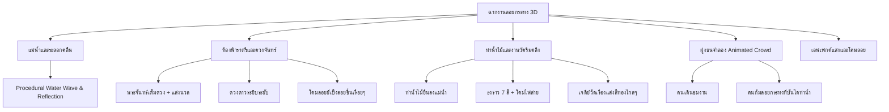
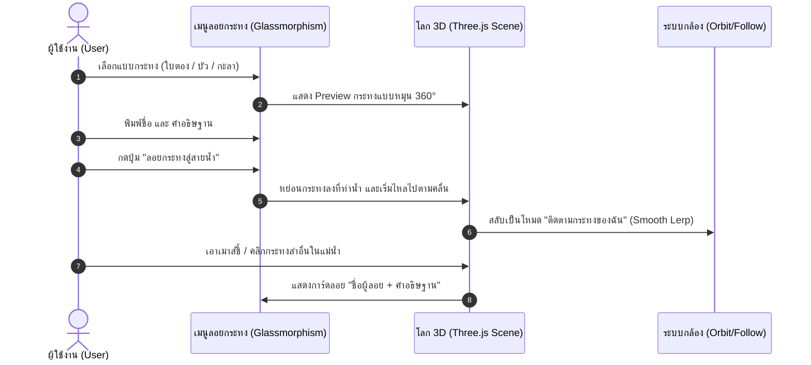

# 🪷 โครงการพัฒนาระบบ 3D จำลองบรรยากาศ "งานประเพณีลอยกระทง" แบบ Interactive
*(Interactive 3D Loy Krathong Festival Simulation)*

---

## 📌 1. ภาพรวมโครงการ (Project Overview)
โครงการนี้มีเป้าหมายเพื่อสร้างเว็บแอปพลิเคชัน 3 มิติ (3D Web Application) จำลองบรรยากาศงานเทศกาลประเพณีลอยกระทงของไทยในคืนวันเพ็ญเดือนสิบสอง โดยเน้นความสมจริง สวยงาม มีชีวิตชีวา ผสานวัฒนธรรมไทยเข้ากับเทคโนโลยีเว็บสมัยใหม่ ผู้ใช้สามารถเลือกกระทง พิมพ์คำอธิษฐาน ปล่อยกระทงลงสู่แม่น้ำ ชมกระทงลอยตามคลื่นน้ำ อ่านคำอธิษฐานของผู้อื่น จุดพลุ และสัมผัสบรรยากาศงานวัดริมน้ำได้อย่างอิสระผ่านเว็บเบราว์เซอร์

---

## 🛠️ 2. สถาปัตยกรรมและเทคโนโลยีหลัก (Technology Stack)

| ส่วนประกอบ | เทคโนโลยี / เครื่องมือ | วัตถุประสงค์การใช้งาน |
| :--- | :--- | :--- |
| **3D Rendering Engine** | [Three.js](https://threejs.org/) | แสดงผลกราฟิก 3D แบบเรียลไทม์บน WebGL |
| **Build Tool & Dev Server**| [Vite](https://vitejs.dev/) | Bundler และ Local Development Server ที่เร็วและเสถียร |
| **Post-Processing** | `EffectComposer`, `UnrealBloomPass` | สร้างเอฟเฟกต์แสงฟุ้งเรืองรอง (Bloom) สำหรับเปลวเทียน โคมลอย พลุ และเจดีย์ทอง |
| **Camera Controls** | `OrbitControls` | ควบคุมมุมกล้อง หมุนรอบ ซูมเข้า-ออกอย่างอิสระ |
| **Procedural Textures** | HTML5 Canvas 2D API | สร้างลวดลายพื้นผิว (Texture/Normal Map) ผ่านโค้ดโดยไม่ต้องพึ่งพาไฟล์ภายนอก |
| **UI Design System** | Vanilla CSS (Glassmorphism) | ส่วนติดต่อผู้ใช้สไตล์กระจกฝ้าโปร่งแสง รองรับภาษาไทยสมบูรณ์ |
| **Ambient Audio (Optional)** | Web Audio API (Synthesizer) | เสียงสังเคราะห์บรรยากาศน้ำไหลและเสียงดนตรีไทยแผ่วเบา โดยไม่ใช้ไฟล์เสียงภายนอก |

---

## 🌌 3. การออกแบบบรรยากาศและฉากหลัง (Scene & Environment)



### 3.1 แม่น้ำและระลอกคลื่น (Dynamic River Surface)
* **การจำลองผิวน้ำ (Wave Displacement):** ใช้ PlaneGeometry ความละเอียดสูง ควบคุมตำแหน่ง Vertex ด้วยฟังก์ชันคลื่นตรีโกณมิติซ้อนกัน:
  $$\text{Height}(x, z, t) = A_1 \sin(k_1 x + \omega_1 t) + A_2 \cos(k_2 z + \omega_2 t) + A_3 \sin(k_3(x + z) + \omega_3 t)$$
* **สีและการสะท้อน:** วัสดุ `MeshStandardMaterial` หรือ Custom Shader สีครามน้ำเงินเข้ม มีค่า Metalness ต่ำ และ Roughness ต่ำ สะท้อนแสงจันทร์และแสงเทียนเป็นประกาย
* **กระแสน้ำ (Current Flow):** กระทงที่ปล่อยลงน้ำจะถูกแรงผลักดันให้เคลื่อนที่ไปตามทิศทางแกน $Z$ หรือ $X$ ของแม่น้ำอย่างนุ่มนวล

### 3.2 ท้องฟ้า ดวงจันทร์ และโคมยี่เป็ง (Night Sky & Sky Lanterns)
* **ดวงจันทร์เต็มดวง:** โมเดลทรงกลมพร้อม Texture เรืองแสงสีนวลตา และ `DirectionalLight` ส่องกระทบผิวน้ำ
* **ดวงดาว:** Particle System กระจายตัวสุ่มกว่า 1,500 จุด พร้อมอนิเมชันกะพริบ (Twinkle effect)
* **โคมลอยยี่เป็ง (Sky Lanterns):**
  * รูปทรงกระบอกหัวมนสีส้มอบอุ่น ทำจากวัสดุโปร่งแสง (Translucent)
  * แต่ละโคมมีแหล่งกำเนิดแสงจำลอง ขยับไหวเล็กน้อยตามลม
  * ค่อยๆ ลอยขึ้นสู่ท้องฟ้าทีละระลอกอย่างไม่ขาดสาย พร้อมเกิดการหมุนวนตามธรรมชาติ

### 3.3 ท่าน้ำไม้ งานวัด และเจดีย์ทอง (Pier & Temple Fairgrounds)
* **ท่าน้ำไม้ (Wooden Pier):** สะพานไม้ต่อเสาลงสู่แม่น้ำ มีบันไดขั้นเตี้ยๆ ให้ตัวละครลงไปจรดริมน้ำ
* **การประดับตกแต่ง:**
  * ธงราวสามเหลี่ยมหลากสีสัน (ธงงานวัด) แขวนพาดระหว่างเสาไม้
  * โคมไฟแขวนกระดาษสาเรืองแสงสลับสี (เหลือง ส้ม แดง เขียว)
* **ฉากหลังงานวัด:**
  * ยอดเจดีย์ทรงไทยโบราณเรืองแสงสีทองอร่าม (Golden Chedi) ตั้งเด่นตัดกับท้องฟ้าค่ำคืน
  * แนวเงาแมกไม้และต้นมะพร้าวริมตลิ่ง

### 3.4 ฝูงชนจำลอง (Animated Crowd Characters)
* **สไตล์ตัวละคร:** Low-poly สไตล์มินิมอล มีเอกลักษณ์และไม่กินทรัพยากรเครื่อง
* **พฤติกรรม (Behaviors):**
  1. *กลุ่มเดินเที่ยว:* ก้าวเท้าและแกว่งแขนเดินวนไปมาระหว่างซุ้มงานวัดกับท่าน้ำ
  2. *กลุ่มยืนชมทิวทัศน์:* ยืนพักผ่อนริมตลิ่ง ชี้ชวนมองกระทงและโคมลอย
  3. *กลุ่มลอยกระทง:* นั่งยองๆ หรือก้มตัวอยู่บริเวณขั้นบันไดท่าน้ำ ปล่อยกระทงเป็นระยะ

---

## 🪷 4. การออกแบบกระทงและระบบลอยกระทง (Interactive Krathong System)

### 4.1 กระทง 3 รูปแบบ (3 Krathong Designs)

```
        [ กระทงใบตองดั้งเดิม ]             [ กระทงดอกบัวสวรรค์ ]           [ กระทงกะลามะพร้าว ]
       ------------------------        -----------------------       ----------------------
       - ฐานหยวกกล้วยสีเขียวเข้ม        - ฐานบัวหลวงสีชมพู/ขาว         - กะลามะพร้าวขัดมันสีน้ำตาล
       - กลีบใบตองพับจีบซ้อนชั้น        - กลีบดอกบัวบานสะพรั่ง        - เทียนขี้ผึ้งหล่อในกะลา
       - ประดับดอกดาวเรืองสีเหลืองสด    - เกสรดอกไม้สีทอง             - ประดับกลีบดอกไม้เล็กๆ
       - ธูป 3 ดอก + เทียนไขสีส้ม       - ธูป 3 ดอก + เทียนไข          - ลอยกระทงสายเรียงตัวสวย
```

### 4.2 ส่วนประกอบของกระทง (Krathong Anatomy)
1. **ฐานกระทง (Base):** รูปทรงกระบอกแบน (หยวกกล้วย) หรือครึ่งทรงกลม (กะลามะพร้าว)
2. **กลีบและดอกไม้ (Petals & Flowers):** กลีบใบตองดัดพับด้วย ConeGeometry หรือ ExtrudeGeometry เรียงตัวแบบรัศมีวงกลม (Polar Coordinate)
3. **เทียนไขและเปลวไฟ (Candle & Flame):**
   * ลำเทียนสีเหลืองนวล
   * เปลวไฟสร้างจากหยดน้ำตาเทียน (Tear-drop mesh) ที่มีการสั่นไหวแบบ Perlin Noise/Sine
   * ผูกติดกับ `PointLight` สีส้มอบอุ่น (`#FFA500`) ที่สว่างวูบวาบตามจังหวะเปลวไฟ ส่องกระทบกลีบและผิวน้ำรอบข้าง
4. **ธูป 3 ดอกและควัน (Incense Sticks & Smoke):**
   * ก้านธูปสีแดง 3 ก้าน ปลายติดไฟสีแดงส้ม
   * อนุภาคควันจางๆ (Soft Particle System) ลอยวนขึ้นสู่ด้านบน

### 4.3 ระบบฟิสิกส์การลอยน้ำ (Floating & Buoyancy Physics)
กระทงทุกลำจะคำนวณตำแหน่งและมุมเอียงตามพื้นผิวคลื่นน้ำแบบ Real-time:
* **ระดับความสูง (Heave):** $Y_{\text{krathong}} = \text{WaveHeight}(X, Z, t)$
* **ความเอียง (Pitch & Roll):** คำนวณความชันของระลอกคลื่น (Surface Normal Gradient) ณ ตำแหน่งนั้น เพื่อให้กระทงเอียงโคลงเคลงไปตามลูกคลื่นอย่างนุ่มนวล
* **การเคลื่อนที่ (Drift):** เคลื่อนที่ไปตามทิศทางการไหลของน้ำ และค่อยๆ หมุนตัวช้าๆ (Slow Yaw Rotation)

---

## 💻 5. ระบบหน้าต่าง UI แบบ Glassmorphism (UI & Interaction Flow)



### 5.1 รายละเอียดส่วนประกอบหน้าจอ (UI Components)
* **กล่องสร้างกระทง (Krathong Creator Modal):**
  * สไตล์ Glassmorphism: พื้นหลังกระจกฝ้าโปร่งแสง (`backdrop-filter: blur(12px)`), ขอบสีขาวบางเบา
  * ปุ่มสลับเลือกประเภทกระทง พร้อมไอคอนกราฟิก
  * ช่องกรอก Input: "ชื่อของคุณ" (Name)
  * ช่องกรอก Textarea: "คำอธิษฐาน / ข้อความส่งท้ายปีเก่าต้อนรับสิ่งดีๆ" (Wish)
  * ปุ่มกด Action สีทองประกาย: **"ลอยกระทง"**
* **แผงควบคุมหลัก (Floating Action Bar):**
  * 🎆 **ปุ่มจุดพลุ (Launch Fireworks):** กดเพื่อยิงพลุเฉลิมฉลองขึ้นสู่ฟ้า
  * 🎥 **ปุ่มมุมกล้อง (Camera Mode):** สลับระหว่าง "หมุนอิสระ (Free Orbit)" กับ "ติดตามกระทงของฉัน (Follow My Krathong)"
  * ℹ️ **ปุ่มวิธีใช้งาน & เกี่ยวกับเทศกาล**
* **ป้ายคำอธิษฐานลอยได้ (Floating Wish Popup):**
  * เมื่อคลิกหรือวางเมาส์เหนือกระทงใดๆ บนผิวน้ำ จะแสดงป้ายข้อมูลการ์ดสีทองโปร่งแสงระบุชื่อและคำอธิษฐาน

---

## 🎆 6. ลูกเล่นพิเศษและระบบเอฟเฟกต์ (Special Effects & Lighting)

### 6.1 ระบบพลุดอกไม้ไฟ (Procedural Fireworks)
1. **การปล่อย (Launch Phase):** พลุพุ่งขึ้นจากฝั่งตรงข้ามเป็นเส้นควันประกายไฟพร้อมเสียงจำลอง
2. **การระเบิด (Explosion Phase):** แตกตัวเป็นทรงกลมด้วย Particle หลายร้อยชิ้นที่มีสีสันสดใส (ทอง, แดง, เขียว, ฟ้า, ชมพู)
3. **การตกตามแรงโน้มถ่วง (Gravity & Drag):** สะเก็ดไฟค่อยๆ ร่วงหล่นและจางหายไปตามกาลเวลา
4. **แสงวาบสะท้อนน้ำ:** สร้าง `PointLight` ชั่วคราวบนจุดระเบิด ส่องสว่างท้องฟ้าและสะท้อนเป็นประกายบนผิวน้ำ
5. **ระบบสุ่มอัตโนมัติ:** ยิงพลุอัตโนมัติทุกๆ 8–15 วินาที เพื่อสร้างบรรยากาศไม่ให้เงียบเหงา

### 6.2 การประมวลผลแสงเงา (Post-Processing & Bloom)
* ติดตั้ง `UnrealBloomPass` บน `EffectComposer`:
  * **Threshold:** 0.7–0.85 (เลือกให้เฉพาะส่วนที่สว่างจัด เช่น เปลวเทียน, ไส้โคมลอย, สะเก็ดพลุ, ยอดเจดีย์ทอง เกิดเอฟเฟกต์ Glow)
  * **Strength:** 1.2–1.6 (ความฟุ้งละมุน ไม่จ้าจนแสบตา)
  * **Radius:** 0.4–0.6 (ระยะการกระจายของแสง)

---

## 📁 7. โครงสร้างไฟล์โปรเจกต์ (Project Directory Structure)

```
RoyKratong/
├── README.md                      # เอกสารสรุปข้อกำหนดและสถาปัตยกรรม (ไฟล์นี้)
├── package.json                   # การกำหนดค่า dependencies (Three.js, Vite)
├── index.html                     # โครงสร้างหน้าเว็บหลักและ UI Glassmorphism
└── src/
    ├── main.js                    # จุดเริ่มต้นของแอปพลิเคชัน (App Entry Point)
    ├── style.css                  # สไตล์ UI ภาษาไทย, Glassmorphism, Responsive
    ├── scene/
    │   ├── sceneManager.js        # ตัวจัดการฉาก, กล้อง, แสง, Render Loop
    │   ├── environment.js         # ท้องฟ้า, พระจันทร์, ดวงดาว, โคมลอยยี่เป็ง
    │   ├── river.js               # ผิวน้ำ, คลื่นระลอก, การสะท้อน
    │   └── pier.js                # ท่าน้ำไม้, เจดีย์ทอง, ธงราว, ซุ้มงานวัด
    ├── models/
    │   ├── krathongGenerator.js   # Procedural 3D Generator (ใบตอง, บัว, กะลา)
    │   └── crowdGenerator.js      # ตัวละครจำลอง Low-poly และแอนิเมชันเดิน/ลอยกระทง
    ├── systems/
    │   ├── floatingPhysics.js     # ฟิสิกส์คลื่นและการลอยของกระทง
    │   ├── fireworksSystem.js     # ระบบพลุดอกไม้ไฟและสะเก็ดแสงสะท้อนน้ำ
    │   └── interactionManager.js  # Raycasting ตรวจจับการคลิกกระทงเพื่ออ่านคำอธิษฐาน
    └── utils/
        └── textureGenerator.js    # Procedural Canvas Textures (ไม่ต้องโหลดรูปจากเน็ต)
```

---

## 📋 8. แผนการดำเนินงานพัฒนา (Implementation Roadmap)

1. **ระยะที่ 1: การเตรียมโครงสร้างพื้นฐาน (Foundation Setup)**
   - ตั้งค่าโปรเจกต์ Vite ร่วมกับ Three.js
   - ติดตั้งตัวช่วยประมวลผลภาพ Post-Processing (Bloom) และ OrbitControls
2. **ระยะที่ 2: การสร้างสภาพแวดล้อม 3D (Environment & Atmosphere)**
   - พัฒนาระบบผิวน้ำเคลื่อนไหวตามสมการคลื่น
   - สรรสร้างฉากราตรี: ท้องฟ้า, พระจันทร์เต็มดวง, ดวงดาวระยิบระยับ, โคมลอยยี่เป็ง
   - ขึ้นรูปท่าน้ำไม้, เจดีย์ทองเรืองแสง และตัวละครจำลองเดินเที่ยวงาน
3. **ระยะที่ 3: ระบบกระทงและฟิสิกส์การลอย (Krathong & Buoyancy System)**
   - สร้างโมเดลกระทง 3 มิติ 3 รูปแบบด้วยโค้ดล้วน (Procedural)
   - ผูกระบบเปลวเทียนไหว, แสง PointLight และควันธูป
   - เชื่อมต่อการคำนวณการโยกคลื่นและการเคลื่อนที่ตามสายน้ำ
4. **ระยะที่ 4: ส่วนต่อประสานผู้ใช้และการโต้ตอบ (UI & Interactions)**
   - พัฒนาหน้าต่าง UI เมนูสไตล์กระจกฝ้า Glassmorphism เป็นภาษาไทย
   - สร้างระบบพิมพ์ชื่อ-คำอธิษฐาน และปล่อยกระทง
   - สร้างระบบคลิก/ชี้กระทงเพื่อเปิดอ่านคำอธิษฐาน
5. **ระยะที่ 5: ลูกเล่นพิเศษและการขัดเกลา (Special FX & Polish)**
   - พัฒนาระบบจุดพลุตามสั่งและการสุ่มจุดอัตโนมัติ
   - ปรับแต่งแสง Bloom ให้กระทงและโคมลอยส่องประกายงดงาม
   - พัฒนาระบบกล้องติดตามกระทงของผู้ใช้ (Follow Krathong Mode)
   - ทดสอบความเข้ากันได้บนเบราว์เซอร์และปรับแต่ง Performance

---
*เอกสารนี้จัดทำขึ้นเป็นพิมพ์เขียว (Blueprint) สถาปัตยกรรมระบบ ก่อนเริ่มต้นเขียนโปรแกรมจริง*
